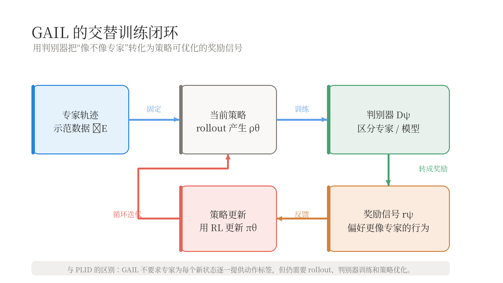

Behavior Cloning 直接拟合专家动作，PLID 则让专家在模型实际访问的状态上补充标签。若不能持续询问专家，能否仍让模型产生与专家相似的轨迹或状态—动作分布？本文从轨迹概率、Forward KL 与状态—动作分布出发，说明 GAIL 如何用判别器间接完成分布匹配。

系列上一篇：[Behavior Cloning 与 PLID](/blog/behavior-cloning-plid/)。前置知识还包括 MDP、条件概率，以及 [Active Learning](/blog/active-learning/#section-5) 中的 KL divergence。

> 模仿学习如何匹配行为分布

## 1. 专家反馈成本

[上一篇](/blog/behavior-cloning-plid/)用 PLID 解决状态分布偏移：当前策略自己 rollout，专家再为实际遇到的状态提供动作标签。方法直接有效，但模型每探索一批新状态，就可能需要专家参与标注。于是产生了另一个问题：

> 如果只有专家轨迹，而没有专家对每个新状态的逐一纠正，能否仍然让模型学到整体上类似专家的行为？

Distribution Matching（分布匹配）改变了比较对象。BC 主要比较给定状态下的动作；Distribution Matching 则试图比较模型与专家产生的轨迹，或者比较它们访问状态—动作对的分布。

## 2. 轨迹分布

一条长度为 $T$ 的轨迹写成：

$$
\tau=(s_0,a_1,s_1,a_2,s_2,\ldots,a_T,s_T)
$$

给定初始状态分布 $p(s_0)$、策略 $\pi$ 和环境转移概率 $P$，轨迹概率可以按链式法则分解为：

$$
p_\pi(\tau)
=
 p(s_0)
 \prod_{t=1}^{T}
 \pi(a_t\mid s_{t-1})
 P(s_t\mid s_{t-1},a_t)
$$

每一项分别表示：初始状态的概率、策略选择动作的概率，以及环境完成状态转移的概率。

专家产生轨迹分布 $p_E(\tau)$，学习策略产生轨迹分布 $p_{\pi_\theta}(\tau)$。最直接的目标是：

$$
p_{\pi_\theta}(\tau)\approx p_E(\tau)
$$

但“两个分布接近”仍然需要选择具体的 divergence。

## 3. Forward KL

### 3.1 最大似然

考虑专家轨迹分布与模型轨迹分布之间的 Forward KL：

$$
D_{\mathrm{KL}}
\left(
 p_E(\tau)\|p_{\pi_\theta}(\tau)
\right)
$$

展开 KL divergence：

$$
\begin{aligned}
&D_{\mathrm{KL}}
\left(
 p_E(\tau)\|p_{\pi_\theta}(\tau)
\right)\\
&=
\mathbb E_{\tau\sim p_E}
\left[
\log p_E(\tau)-\log p_{\pi_\theta}(\tau)
\right]
\end{aligned}
$$

第一项与 $\theta$ 无关，所以最小化 Forward KL 等价于最大化专家轨迹在模型下的对数概率：

$$
\hat\theta
=
\arg\max_\theta
\mathbb E_{\tau\sim p_E}
\left[
\log p_{\pi_\theta}(\tau)
\right]
$$

有限样本下，这就是轨迹级最大似然。

### 3.2 与 BC 的关系

将轨迹概率代入：

$$
\begin{aligned}
\log p_{\pi_\theta}(\tau)
={}&
\log p(s_0)\\
&+\sum_{t=1}^{T}\log\pi_\theta(a_t\mid s_{t-1})\\
&+\sum_{t=1}^{T}\log P(s_t\mid s_{t-1},a_t)
\end{aligned}
$$

如果专家和模型使用相同的环境动力学，且初始状态分布不依赖 $\theta$，那么环境相关的两部分都是常数。剩下的优化目标是：

$$
\hat\theta
=
\arg\max_\theta
\sum_{n=1}^{N}
\sum_{t=1}^{T}
\log\pi_\theta(a_{n,t}\mid s_{n,t-1})
$$

这正是专家轨迹上的 Behavior Cloning。

因此，必须保留一个重要结论：

> 把 BC 写成完整轨迹的 Forward KL，并不会自动解决状态分布偏移；如果期望仍然来自专家轨迹，模型仍然主要在专家状态上学习。

## 4. 状态—动作分布

### 4.1 联合分布

在某个时间步，状态—动作联合分布可以写成：

$$
p_\pi(s,a)=d_\pi(s)\pi(a\mid s)
$$

其中 $d_\pi(s)$ 表示策略 $\pi$ 诱导的状态访问分布。

对同一时间步的联合分布使用 KL divergence，可以得到链式分解：

$$
\begin{aligned}
&D_{\mathrm{KL}}
\left(
 p_E(s,a)\|p_\theta(s,a)
\right)\\
&=
D_{\mathrm{KL}}
\left(
 d_E(s)\|d_\theta(s)
\right)\\
&\quad+
\mathbb E_{s\sim d_E}
\left[
D_{\mathrm{KL}}
\left(
 \pi_E(\cdot\mid s)\|\pi_\theta(\cdot\mid s)
\right)
\right]
\end{aligned}
$$

右侧第一项是状态访问分布匹配，第二项是给定状态下的动作匹配，也就是 BC 的核心。

这给出一个清晰的解释：

> 联合分布匹配 = 状态访问频率匹配 + 给定状态下的动作匹配。

### 4.2 Occupancy measure

在无限时域或不同时间步混合的场景下，更常用的是 discounted occupancy measure：

$$
\rho_\pi(s,a)
=
(1-\gamma)
\sum_{t=0}^{\infty}
\gamma^t
P_\pi(s_t=s,a_t=a)
$$

它描述策略在整个执行过程中访问某个状态—动作对的总体频率，并使用 $\gamma$ 对较晚时间步进行折扣。

需要注意：匹配每个时间步的边缘分布，不一定等价于匹配完整轨迹中的所有长程依赖。GAIL 更准确的理论对象通常是 occupancy measure，而不是简单地把每条轨迹当成一个独立分类样本。

## 5. KL 的方向

KL divergence 是有方向的（基本定义见 [Active Learning](/blog/active-learning/#section-5)）。Forward KL $D_{\mathrm{KL}}(p_E\|p_\theta)$ 从专家分布出发，要求模型覆盖专家分布中的区域；如果模型遗漏了专家行为，惩罚会很大。

Reverse KL $D_{\mathrm{KL}}(p_\theta\|p_E)$ 则从模型分布出发，更强地惩罚模型访问专家概率很低的区域。它常被解释为更偏向选择高密度模式，但在多峰分布和有限数据下也可能出现 mode-seeking 行为。

这两种 KL 的区别不能简单归结为“哪个更好”：选择哪种方向，取决于我们更关心覆盖专家行为，还是避免模型产生专家分布之外的行为。真实系统中还必须考虑分布支持、估计误差和 rollout 成本。

## 6. GAIL

### 6.1 二分类目标

当专家分布和模型分布只有样本、没有容易计算的密度函数时，可以训练一个判别器判断样本来自哪里。

令：

$$
D_\psi(s,a)\in(0,1)
$$

表示状态—动作对 $(s,a)$ 来自专家的概率。判别器的二分类损失为：

$$
\begin{aligned}
\mathcal L_D(\psi)
={}&
-\mathbb E_{(s,a)\sim p_E}
\left[
\log D_\psi(s,a)
\right]\\
&-
\mathbb E_{(s,a)\sim p_{\pi_\theta}}
\left[
\log\left(1-D_\psi(s,a)\right)
\right]
\end{aligned}
$$

专家样本的标签是 1，模型样本的标签是 0。最小化这个损失会让判别器越来越善于区分两种行为。

### 6.2 策略奖励

策略的目标与判别器相反：它希望生成让判别器难以区分的状态—动作对。

在固定判别器时，可以把判别器输出转化为策略奖励。例如采用：

$$
r_\psi(s,a)
=
-\log\left(1-D_\psi(s,a)\right)
$$

当判别器认为 $(s,a)$ 更像专家时，$D_\psi(s,a)$ 较大，对应的奖励也较高。于是策略可以通过强化学习最大化：

$$
\max_\theta
\mathbb E_{\tau\sim p_{\pi_\theta}}
\left[
\sum_t r_\psi(s_t,a_t)
\right]
$$

训练过程交替进行：

1. 用专家数据和当前策略 rollout 数据训练判别器；
2. 固定判别器，把它的输出当作奖励；
3. 用 policy gradient、PPO 等方法更新策略；
4. 让新策略继续 rollout，再更新判别器。

这也是 GAIL（Generative Adversarial Imitation Learning）的核心闭环。

### 6.3 密度比

固定策略分布，令 $x$ 表示一个轨迹或状态—动作对。判别器在 $x$ 上的损失贡献为：

$$
\mathcal J_x(D)
=
-p_E(x)\log D(x)
-p_\theta(x)\log(1-D(x))
$$

对 $D(x)$ 求导并令其为零：

$$
D^*(x)
=
\frac{p_E(x)}{p_E(x)+p_\theta(x)}
$$

因此：

$$
\log\frac{D^*(x)}{1-D^*(x)}
=
\log\frac{p_E(x)}{p_\theta(x)}
$$

这说明最优判别器的 log-odds 等于专家分布与模型分布的 log density ratio。我们不必显式计算两个高维分布的密度，只需训练一个分类器，就可以间接获得分布比值信息。

### 6.4 JS 散度

在理想判别器条件下，将最优判别器代回对抗目标，得到的是与 Jensen–Shannon divergence（JS 散度）相关的目标，而不是简单的 Reverse KL。

因此，GAIL 应理解为：

```
Distribution Matching
        ↓
Two-sample classification
        ↓
Adversarial training
        ↓
Occupancy measure matching
```

## 7. 训练边界

GAIL 不需要专家为每个新状态提供动作标签，但它并没有消除数据和交互成本：

- 当前策略仍然需要在环境中 rollout；
- 判别器需要同时看到专家样本和模型样本；
- 策略更新通常需要强化学习算法；
- 判别器可能过拟合有限的专家数据；
- 判别器学到的信号可能被策略 exploit；
- 离线专家数据与在线环境状态之间可能存在支持不匹配。

一个更完整的工程流程是：



*GAIL 的交替训练闭环*

还需要检查几个理论与实际不完全对齐的地方：

1. **部分可观测性**：如果状态没有包含必要历史，判别器可能把历史差异错误地归因于当前动作。
2. **动作延迟**：专家标签、观测和动作可能存在时间错位。
3. **专家多样性**：单一判别器可能把某一种专家风格误认为唯一正确行为。
4. **奖励 hacking**：策略可能找到让判别器失效的行为，而不是完成真正任务。
5. **安全约束**：探索和 rollout 不能无限制地尝试危险状态。
6. **评估问题**：判别器准确率下降不等于任务成功率提高。

## 8. 总结

Behavior Cloning 主要在专家访问过的状态上匹配动作。PLID 让模型主动探索，再由专家标注模型实际遇到的状态。Distribution Matching 则进一步尝试匹配专家和模型产生的状态—动作分布。

但直接最小化轨迹 Forward KL，在固定环境动力学下可能退化为专家轨迹上的 BC。因此，真正需要匹配的是策略诱导的状态访问分布或 occupancy measure。

GAIL 用一个二分类器区分专家与模型，再把判别器信号转化为策略奖励。它的关键数学事实是：最优判别器的 log-odds 等于两个分布的 log density ratio；在理想条件下，对抗目标与 JS divergence 相关。

如果说 BC 是“模仿专家在这个状态下做什么”，PLID 是“让专家纠正模型实际遇到的状态”，那么 GAIL 更接近于：

> 让模型产生整体上无法被判别器与专家区分的行为。

## 参考资料

- [课程讲义](https://github.com/enalisnick/enalisnick.github.io/blob/master/ML_with_Humans_Course_Notes.pdf)
- 系列上一篇：[Behavior Cloning 与 PLID](/blog/behavior-cloning-plid/)

