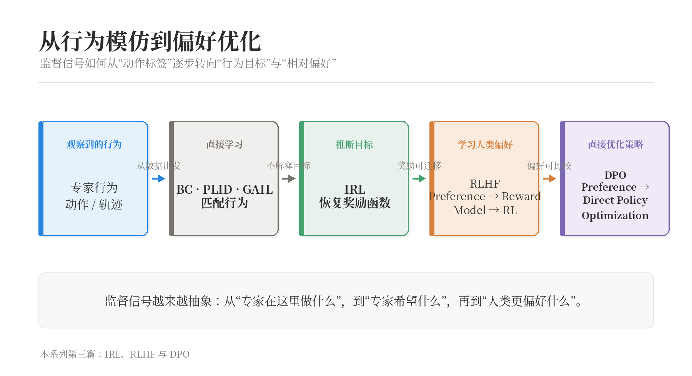

Behavior Cloning、PLID 和 GAIL 主要学习专家如何行动。若希望模型在新环境中仍能做出合理决策，就需要进一步理解专家行为背后的目标。本文从 Inverse Reinforcement Learning 出发，说明如何从专家行为推断奖励，并连接到 RLHF 与 DPO。

系列前文：[Behavior Cloning 与 PLID](/blog/behavior-cloning-plid/)、[Distribution Matching 与 GAIL](/blog/distribution-matching-gail/)。

> IRL、RLHF 与 DPO 如何逐步改变监督信号

## 1. 问题转向

前两篇介绍了三种直接学习行为的方式：

- Behavior Cloning 在专家访问过的状态上拟合动作；
- PLID 让当前策略探索，再由专家标注模型实际遇到的状态；
- GAIL 通过判别器，让模型产生难以与专家区分的状态—动作分布。

它们都主要回答：

> 专家在这个状态下做了什么？

但在环境变化、任务目标变化或专家行为存在多种合理解释时，直接复制动作可能不够。我们可能更希望理解：

> 专家为什么做这个选择？它在优化什么目标？

这就是 Inverse Reinforcement Learning（逆强化学习，IRL）的出发点。

普通强化学习的方向是：

$$
R\longrightarrow\pi^*
$$

给定奖励函数 $R$，求在该奖励下表现最好的策略 $\pi^*$。

IRL 则试图反过来：

$$
\pi_E\longrightarrow\hat R_\phi\longrightarrow\hat\pi
$$

先观察专家策略 $\pi_E$，推断一个能够解释专家行为的奖励函数 $R_\phi$，再在这个奖励下重新优化策略。

需要先强调：IRL 找到的通常是一个**可以解释专家行为的奖励函数**，不一定是专家真实的心理动机。

## 2. 方法对照

不同方法的已知信息与学习对象如下：

- **RL**：已知奖励函数；学习策略；如何最大化已知目标？
- **BC / PLID**：已知专家状态—动作；学习策略；如何直接复制专家行为？
- **GAIL**：已知专家轨迹；学习策略；如何匹配行为分布？
- **IRL**：已知专家行为，奖励未知；学习奖励函数，再学习策略；专家行为背后的目标是什么？
- **RLHF**：已知人类偏好比较；学习奖励模型，再优化策略；哪个行为更符合人类偏好？
- **DPO**：已知人类偏好比较；学习直接优化策略；能否绕过显式奖励模型？

这张表也说明了第三篇的主线：监督信号逐渐从具体动作变得更加抽象。

## 3. IRL 形式化

### 3.1 参数化奖励

假设奖励函数未知，我们用带参数的函数表示它：

$$
R_\phi(s)
$$

其中 $\phi$ 是奖励函数的参数。给定策略 $\pi_\theta$，其期望折扣回报为：

$$
J(\theta,\phi)
=
\mathbb E_{\tau\sim p_{\pi_\theta}}
\left[
\sum_{t=0}^{T-1}
\gamma^t R_\phi(s_t)
\right]
$$

改变 $\theta$ 会改变模型访问的状态；改变 $\phi$ 会改变每个状态的价值。因此 IRL 中的策略和奖励参数通常通过交替过程共同出现。

### 3.2 线性奖励

为了让问题可分析，常假设奖励由状态特征线性组合而成：

$$
R_\phi(s)
=
\phi^\top\psi(s)
$$

其中：

- $\psi(s)\in\mathbb R^d$ 是状态特征向量；
- $\phi\in\mathbb R^d$ 是每个特征的奖励权重。

例如在导航任务中，特征可以表示：

- 距离目标的远近；
- 与障碍物的距离；
- 速度或能耗；
- 是否发生碰撞。

线性假设不是说真实奖励一定线性，而是将问题限制在一个可解释、可优化的函数族中。

## 4. 特征期望匹配

### 4.1 累计特征

定义策略 $\pi$ 的累计特征期望：

$$
\mu_\pi
=
\mathbb E_{\tau\sim p_\pi}
\left[
\sum_{t=0}^{T-1}
\gamma^t\psi(s_t)
\right]
$$

在线性奖励下，策略的期望回报可以写成：

$$
J(\pi,\phi)
=
\phi^\top\mu_\pi
$$

推导如下：

$$
\begin{aligned}
J(\pi,\phi)
&=
\mathbb E_{\tau\sim p_\pi}
\left[
\sum_{t=0}^{T-1}
\gamma^t\phi^\top\psi(s_t)
\right]\\
&=
\phi^\top
\mathbb E_{\tau\sim p_\pi}
\left[
\sum_{t=0}^{T-1}
\gamma^t\psi(s_t)
\right]\\
&=
\phi^\top\mu_\pi
\end{aligned}
$$

这里使用了内积的线性性以及期望与线性变换可以交换。

### 4.2 匹配的作用

设专家的累计特征期望为 $\mu_E$，模型的累计特征期望为 $\mu_\pi$。在同一个奖励函数下，二者的回报差为：

$$
\left|
J(\pi_E,\phi)-J(\pi,\phi)
\right|
=
\left|
\phi^\top(\mu_E-\mu_\pi)
\right|
$$

根据 Cauchy–Schwarz 不等式：

$$
\left|
\phi^\top(\mu_E-\mu_\pi)
\right|
\leq
\|\phi\|_2
\|\mu_E-\mu_\pi\|_2
$$

因此，当模型和专家的累计特征期望接近时，在满足参数约束的一族线性奖励函数下，它们的表现差异也会受到控制。

这就是 Feature Expectation Matching（特征期望匹配）的核心直觉。

### 4.3 真实奖励

特征期望匹配并不能保证找到专家真实的奖励函数。它只说明：在选定特征和约束范围内，模型的行为统计与专家相近。

如果特征没有表达“安全”这一维度，即使模型和专家在已有特征上匹配，模型也可能在安全性上表现很差。这是特征设计带来的限制。

## 5. Maximum Entropy IRL

### 5.1 多种合理行为

现实中的专家并不一定每次都采取完全相同的动作。即使面对同一个任务，也可能存在多条都合理的路线。

如果我们把专家行为强行解释成唯一最优轨迹，就可能把偶然选择误认为必然目标。Maximum Entropy IRL 的思路是：在能够解释专家数据的前提下，选择额外假设最少的行为分布。

一种常见形式是定义轨迹分布：

$$
p_\phi(\tau)
=
\frac{1}{Z(\phi)}
\exp
\left(
\sum_{t=0}^{T-1}
R_\phi(s_t)
\right)
$$

其中 $Z(\phi)$ 是 partition function，用来保证所有轨迹概率之和为 1：

$$
Z(\phi)
=
\sum_\tau
\exp
\left(
\sum_{t=0}^{T-1}
R_\phi(s_t)
\right)
$$

奖励高的轨迹概率更大，但其他轨迹仍然可能出现。

### 5.2 奖励梯度

给定专家轨迹数据，最大化其对数似然：

$$
\mathcal L(\phi)
=
\mathbb E_{\tau\sim p_E}
\left[
\log p_\phi(\tau)
\right]
$$

对参数 $\phi$ 求梯度，得到“专家特征期望减去模型特征期望”的结构：

$$
\nabla_\phi\mathcal L
=
\mu_E
-
\mathbb E_{\tau\sim p_\phi}
\left[
\mu_\tau
\right]
$$

这里 $\mu_\tau$ 表示单条轨迹的累计特征向量。

这条公式的直觉是：

- 如果模型产生的某个特征少于专家，就提高该特征对应的奖励；
- 如果模型产生的某个特征多于专家，就降低对应奖励；
- 训练通过比较专家与模型的行为统计量来更新奖励函数。

由于模型特征期望通常需要从当前策略 rollout 中估计，IRL 往往包含“更新奖励—用 RL 优化策略—重新比较行为”的循环。

### 5.3 奖励歧义

奖励函数存在不可辨识性。一个极端例子是：

$$
R(s,a)=0
$$

在这个奖励下，所有策略的回报都相同，因此专家策略也可以被视为最优策略。但这个奖励没有解释专家究竟偏好什么。

因此，IRL 的目标不是机械地寻找任何一个能让专家成为最优的奖励函数，而是通过函数族限制、正则化、最大熵假设或额外偏好数据，寻找更有用的解释。

## 6. RLHF

### 6.1 偏好比较

在许多任务中，人类很难给一个行为指定稳定的绝对奖励，但比较两个行为的相对优劣要容易得多。

例如，对于同一个问题，模型生成两个回答。人类可能很难判断它们应该分别得到 8.1 分还是 8.6 分，但通常可以判断哪个回答更好。

RLHF（Reinforcement Learning from Human Feedback）的关键变化是：

> 不要求人类直接写出奖励函数，而是从人类对行为的偏好比较中学习奖励模型。

### 6.2 Bradley–Terry

设 $x$ 是 prompt，$y^+$ 是人类偏好的回答，$y^-$ 是较不受偏好的回答。偏好数据写成：

$$
\mathcal D_\pm
=
\left\{
(x_n,y_n^+,y_n^-)
\right\}_{n=1}^{N}
$$

奖励模型记为 $r_\phi(x,y)$。Bradley–Terry 模型假设：

$$
P(y^+\succ y^-\mid x)
=
\sigma
\left(
 r_\phi(x,y^+)-r_\phi(x,y^-)
\right)
$$

其中 $\sigma$ 是 sigmoid 函数。

如果偏好回答的奖励比另一回答高很多，模型预测人类选择它的概率就更高。

于是可以用二元交叉熵训练 Reward Model：

$$
\mathcal L_{\mathrm{RM}}(\phi)
=
-\mathbb E_{(x,y^+,y^-)}
\left[
\log
\sigma
\left(
 r_\phi(x,y^+)-r_\phi(x,y^-)
\right)
\right]
$$

奖励模型不需要让奖励值具有绝对意义。对所有回答的奖励同时加上一个常数，偏好概率不会改变，因为真正起作用的是奖励差：

$$
\bigl(r(x,y^+)+c\bigr)
-
\bigl(r(x,y^-)+c\bigr)
=
 r(x,y^+)-r(x,y^-)
$$

### 6.3 RLHF 流程

经典 RLHF 通常可以分为三步：

1. 用监督微调得到初始策略 $\pi_0$；
2. 让模型生成候选回答，由人类进行偏好比较，训练 Reward Model；
3. 使用 RL 优化策略，使其获得更高奖励，同时不要偏离 reference policy 太远。

因此，RLHF 仍然保留了 IRL 的两阶段结构：

$$
\text{行为偏好}
\longrightarrow
\text{奖励模型}
\longrightarrow
\text{策略优化}
$$

它与 IRL 的区别主要在于监督形式不同：IRL 通常观察专家行为，RLHF 则直接获得人类对行为的相对偏好。

## 7. DPO

### 7.1 KL 正则化

经典 RLHF 的策略优化目标可以写成：

$$
\max_{\pi_\theta}
\mathbb E_{y\sim\pi_\theta(\cdot\mid x)}
\left[
 r(x,y)
\right]
-
\beta
D_{\mathrm{KL}}
\left(
 \pi_\theta(\cdot\mid x)
\|\pi_0(\cdot\mid x)
\right)
$$

第一项鼓励模型生成高奖励回答，第二项约束当前策略不要偏离 reference policy $\pi_0$ 太远。

参数 $\beta>0$ 控制偏离惩罚：$\beta$ 越大，策略越接近 reference policy。

### 7.2 最优策略

对于固定的 prompt $x$，KL 正则化目标的最优策略具有如下形式：

$$
\pi^*(y\mid x)
=
\frac{1}{Z(x)}
\pi_0(y\mid x)
\exp
\left(
\frac{r(x,y)}{\beta}
\right)
$$

其中 $Z(x)$ 是归一化因子。

整理可得：

$$
r(x,y)
=
\beta
\log
\frac{\pi^*(y\mid x)}{\pi_0(y\mid x)}
+
\beta\log Z(x)
$$

这意味着，在 KL 正则化 RL 的最优解下，奖励可以用最优策略相对于 reference policy 的 log-probability ratio 表示。

### 7.3 偏好代入

对一对回答 $y^+$ 和 $y^-$，奖励差中的归一化项会抵消：

$$
\begin{aligned}
&r(x,y^+)-r(x,y^-)\\
&=
\beta
\left[
\log\frac{\pi^*(y^+\mid x)}{\pi_0(y^+\mid x)}
-
\log\frac{\pi^*(y^-\mid x)}{\pi_0(y^-\mid x)}
\right]
\end{aligned}
$$

将未知的最优策略 $\pi^*$ 用当前策略 $\pi_\theta$ 近似，再代入 Bradley–Terry 偏好模型，就得到 DPO 的直接偏好优化目标：

$$
\begin{aligned}
\mathcal L_{\mathrm{DPO}}(\theta)
=-\mathbb E_{(x,y^+,y^-)}
\Bigg[
\log\sigma\Bigg(
\beta
\Big[
&\log\frac{\pi_\theta(y^+\mid x)}{\pi_0(y^+\mid x)}\\
-&\log\frac{\pi_\theta(y^-\mid x)}{\pi_0(y^-\mid x)}
\Big]
\Bigg)
\Bigg]
\end{aligned}
$$

DPO 的核心含义是：

- 提高偏好回答相对于 reference policy 的概率；
- 降低非偏好回答相对于 reference policy 的概率；
- 用偏好数据直接训练策略，而不是先单独训练 Reward Model，再使用 PPO 等 RL 算法优化策略。

### 7.4 边界

DPO 绕过的是显式的 Reward Model 和策略阶段的在线 RL 优化流程，但它并没有消除所有问题：

- 偏好数据仍然可能有噪声和标注偏差；
- reference policy 会影响优化结果；
- 离线偏好数据可能无法覆盖模型部署时的状态；
- 模型可能学习标注者偏好的表面模式，而不是真正的任务质量；
- 长回答与短回答之间可能存在长度偏差。

因此，DPO 不是“无需奖励、无需假设”的方法，而是将奖励与参考策略的关系隐含进了直接偏好优化目标。

## 8. 系列串联

现在可以把本系列的三篇文章放在同一张图中理解：

*监督信号从动作标签逐步转向行为目标与相对偏好。*

三篇文章的分工是：

1. **Behavior Cloning 到 PLID**：为什么专家状态分布与模型状态分布不同；
2. **Distribution Matching 到 GAIL**：如何让模型整体行为接近专家分布；
3. **IRL、RLHF 与 DPO**：当行为背后的目标未知时，如何从行为或偏好学习目标。

## 9. 总结

IRL 把模仿学习的问题从“专家做了什么”推进到“专家可能在优化什么”。在线性奖励和特征期望匹配的设定下，专家与模型的行为差异可以通过累计特征统计量来分析；Maximum Entropy IRL 则允许专家存在多种合理行为，并通过专家与模型的特征期望差异更新奖励参数。

RLHF 改变了监督信号：人类不必直接给出绝对奖励，只需要比较两个行为哪个更好。Reward Model 将这些相对偏好转化为可优化的奖励。

DPO 则进一步利用 KL 正则化 RL 的解析关系，把奖励差表示为当前策略与 reference policy 的 log-probability ratio，从而直接用偏好数据更新策略。

因此，第三篇的主线可以概括为：

> 从复制专家行为，到推断行为目标，再到直接利用人类偏好优化策略。

## 参考资料

- [课程讲义](https://github.com/enalisnick/enalisnick.github.io/blob/master/ML_with_Humans_Course_Notes.pdf)
- 系列：[Imitation Learning](/series/imitation-learning/)
- 系列第一篇：[Behavior Cloning 与 PLID](/blog/behavior-cloning-plid/)
- 系列第二篇：[Distribution Matching 与 GAIL](/blog/distribution-matching-gail/)
